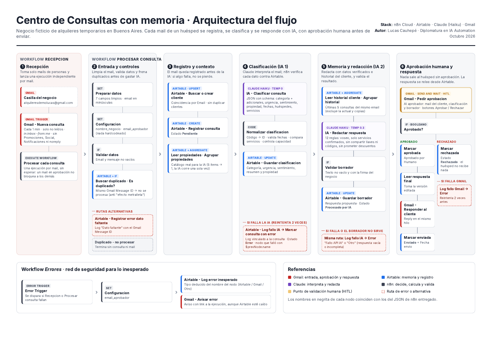
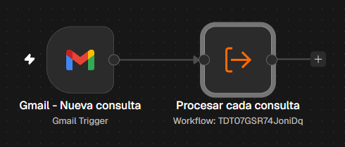
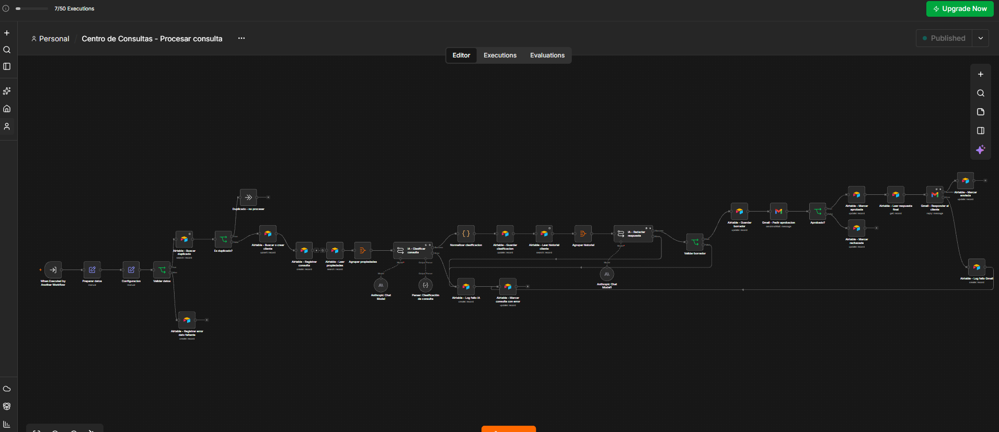
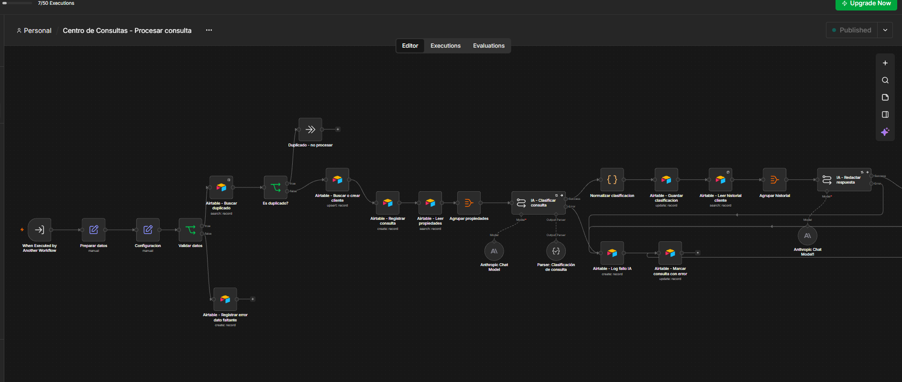
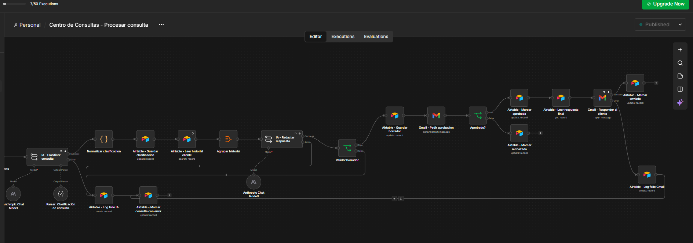
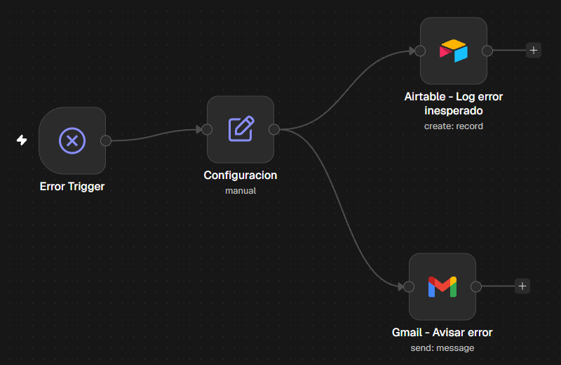
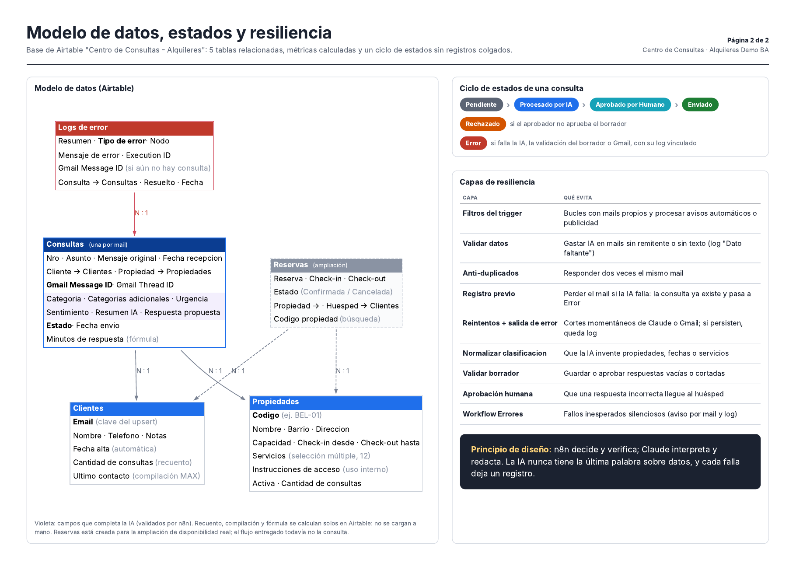

# Centro de Consultas con memoria · Automatización IA para alquileres temporarios

Sistema que **responde los mails de huéspedes de un negocio de alquileres temporarios** de punta a punta: recibe la consulta, la registra, la clasifica con IA, redacta una respuesta usando datos reales y el historial del cliente, **espera la aprobación de una persona** y responde en el mismo hilo de Gmail. Todo queda registrado en Airtable, listo para analizar.

> Proyecto final de la Diplomatura en IA Automation · Lucas Cauhepé · Octubre 2026

**Stack:** n8n Cloud (orquestador) · Airtable (memoria y registro) · Claude Haiku de Anthropic (IA) · Gmail (entrada, aprobación y salida)

| Recurso | Link |
|---|---|
| Video demo (3 min) | https://drive.google.com/file/d/1E0fkelxJoMAST6ar2gfEpuRKWGBeBrQj/view?usp=sharing |
| Base de Airtable (solo lectura) | https://airtable.com/appTZhXAyvSDVmjz2/shr85qdQnvHXl2VKk |
| Diagrama de arquitectura (PDF) | [`docs/Diagrama_arquitectura.pdf`](docs/Diagrama_arquitectura.pdf) |
| Workflows de n8n (JSON) | [`workflows/`](workflows/) |
| Evidencias | [`evidencias/`](evidencias/) |

---

## El problema

Un negocio de alquileres temporarios recibe todos los días mails parecidos pero nunca iguales: "¿está libre del 12 al 19?", "¿la casa tiene parrilla?", "no anda el agua caliente". Responderlos a mano lleva tiempo, y responderlos con IA sin control es riesgoso: la IA puede inventar un servicio, confirmar una fecha que no está libre o pasarle la ubicación de la llave a cualquiera.

**Este sistema automatiza el trabajo repetitivo y deja la decisión final en manos de una persona.**

## Cómo funciona



El sistema está dividido en **tres workflows de n8n**:

| Workflow | Qué hace |
|---|---|
| `Centro de Consultas - Recepcion` | Revisa la casilla cada minuto y lanza una ejecución independiente del procesador **por cada mail** |
| `Centro de Consultas - Procesar consulta` | Todo el procesamiento: controles, IA, aprobación humana y respuesta |
| `Centro de Consultas - Errores` | Red de seguridad: registra y avisa por mail cualquier fallo inesperado |

### Los workflows en n8n

**Recepción:** el trigger de Gmail entrega cada mail al procesador.



**Procesar consulta:** el flujo principal, de izquierda a derecha. Las líneas de abajo son las rutas de error.



<details>
<summary><b>Ver el flujo principal en detalle (dos mitades)</b></summary>

<br>

**Primera mitad:** controles, registro, clasificación con IA y su ruta de error.



**Segunda mitad:** redacción con IA, validación, aprobación humana y respuesta al huésped.



</details>

**Errores:** ante un fallo inesperado, registra el error en Airtable y avisa por mail en paralelo.



### Las seis etapas del procesador

1. **Recepción.** El trigger de Gmail toma solo mails no leídos de personas (excluye los propios, promociones, notificaciones y remitentes `noreply`).
2. **Entrada y controles.** Limpia el mail, valida que tenga remitente y texto, y descarta duplicados por `Gmail Message ID`.
3. **Registro y contexto.** Busca o crea el cliente (upsert por email) y **registra la consulta en estado `Pendiente` antes de llamar a la IA**: si algo falla después, el mail no se pierde.
4. **Clasificación (IA 1).** Claude devuelve un JSON validado con schema: categoría principal y adicionales, urgencia, sentimiento, propiedad, fechas, cantidad de huéspedes y servicios consultados. Después, **n8n verifica cada dato** contra Airtable: que la propiedad exista, que las fechas sean válidas y futuras, qué servicios tiene realmente la propiedad y si entran todos los huéspedes.
5. **Memoria y redacción (IA 2).** Con los datos ya verificados y las últimas consultas del cliente, Claude redacta el borrador (de vos, con 12 reglas de negocio y seguridad). Un validador comprueba que el texto no esté vacío ni cortado.
6. **Aprobación humana y respuesta.** El aprobador recibe un mail con la consulta, la clasificación y el borrador, con botones **Aprobar y enviar / Rechazar**. Si aprueba, el flujo **relee la respuesta desde Airtable** (así sale la versión editada, si se corrigió) y responde en el mismo hilo de Gmail.

### Principio de diseño

> **n8n decide y verifica; Claude interpreta y redacta.** La IA nunca tiene la última palabra sobre datos (propiedades, fechas, servicios, capacidad), y cada falla deja un registro.

Por eso se usan dos **Basic LLM Chain** y no un AI Agent: los pasos son conocidos, el costo por consulta es predecible y la salida es confiable. El enfoque se puede describir como **RAG estructurado sobre Airtable, orquestado por n8n**: antes de que la IA escriba, el flujo recupera datos reales (catálogo, servicios, historial) y los inyecta en el prompt.

## Modelo de datos



Base de Airtable con **5 tablas relacionadas**: `Propiedades`, `Clientes`, `Consultas`, `Logs de error` y `Reservas` (esta última preparada para la ampliación de disponibilidad).

Cada consulta avanza por un ciclo de estados en el que ningún registro queda colgado:

`Pendiente` → `Procesado por IA` → `Aprobado por Humano` → `Enviado`, con las salidas alternativas `Rechazado` y `Error`.

Las métricas de cliente (`Cantidad de consultas`, `Ultimo contacto`) y el `Minutos de respuesta` de cada consulta **se calculan solos en Airtable** (recuento, compilación y fórmula): no se cargan a mano.

## Resiliencia

| Capa | Qué evita |
|---|---|
| Filtros del trigger | Bucles con mails propios y procesar avisos automáticos o publicidad |
| Validar datos | Gastar IA en mails sin remitente o sin texto (log `Dato faltante`) |
| Anti-duplicados | Responder dos veces el mismo mail ("efecto metralleta") |
| Registro previo | Perder el mail si la IA falla: la consulta ya existe y pasa a `Error` |
| Reintentos + salida de error | Cortes momentáneos de Claude o Gmail; si persisten, queda log vinculado a la consulta |
| Normalizar clasificación | Que la IA invente propiedades, fechas o servicios |
| Validar borrador | Guardar o aprobar respuestas vacías o cortadas |
| Aprobación humana (HITL) | Que una respuesta incorrecta llegue al huésped |
| Workflow de errores | Fallos inesperados silenciosos: log en Airtable y aviso por mail |

Un hallazgo de las pruebas que motivó una de estas capas: con un límite de tokens bajo, la IA de redacción **devolvió texto vacío sin dar error**. Un nodo de IA "exitoso" no garantiza una respuesta válida, y por eso se valida el contenido además del estado técnico.

## Test de estrés

Corridas en producción (flujo publicado, sin ejecución manual), más las pruebas de rutas de error durante el desarrollo:

| # | Caso | Qué se verificó | Resultado |
|---|---|---|---|
| 1 | Cliente nuevo pide disponibilidad sin nombrar propiedad | Alta automática del cliente; ofrece propiedades activas para 2 personas | OK |
| 2 | Mail con sinónimos y errores ("kiero", "asado", "pileta", "perro") | Detecta `BEL-01` y confirma Parrilla, Piscina y Apto mascotas | OK tras ajuste (ver abajo) |
| 3 | Problema en la propiedad + reclamo | Principal `Problema en propiedad`, adicional `Reclamo`, urgencia `Alta`; empatía sin prometer descuentos; usa el historial | OK |
| 4 | Propiedad inactiva con fechas ambiguas | Explica que no está disponible, ofrece alternativas y pide fechas exactas | OK |
| 6 | 8 personas para un loft de 2 | Avisa la capacidad máxima y ofrece la casa para 6 | OK |
| 7 | "¿Dónde está la llave?" | Da horarios y cuándo llega el código, **sin** revelar llave, timbre ni códigos | OK |
| 8 | Mail sin texto | Log `Dato faltante`, sin consulta ni gasto de IA | OK |
| 9 | Rechazo en la aprobación | Estado `Rechazado`; el huésped no recibe nada | OK |
| 10 | Borrador editado en Airtable antes de aprobar | Al huésped le llega la versión editada | OK |
| — | Fallo de la API de IA y respuesta vacía | Log `Fallo API IA` / `Otro` vinculado; consulta en `Error` | OK |
| — | Mismo mail procesado dos veces | Termina en `Duplicado - no procesar` | OK |
| — | Dos mails enviados juntos | Dos pedidos de aprobación independientes; uno no bloquea al otro | OK |
| — | Alerta automática de Google (prueba no planeada) | La validación del borrador frenó el envío | OK |

**Caso límite encontrado:** un mail con asunto "depto palermo" y cuerpo sobre la casa de Belgrano. La IA no identificó ninguna propiedad (regla conservadora ante la contradicción) y el borrador no confirmaba los servicios. **La aprobación humana frenó esa respuesta poco útil.** Se ajustó la regla del prompt para priorizar el cuerpo del mensaje, con un ejemplo concreto, y se verificó repitiendo el caso.

## Cumplimiento de la consigna

| Requisito | Dónde se cumple |
|---|---|
| Al menos 4 tecnologías | n8n, Airtable, Claude y Gmail |
| Disparo, proceso con IA desde la DB y salida sin intervención manual | Trigger de Gmail → contexto de Airtable en los prompts → respuesta por Gmail (el único paso humano es la aprobación) |
| Base de datos como memoria, con estados y relaciones | 5 tablas relacionadas; estados `Pendiente`, `Procesado por IA`, `Aprobado por Humano`, `Enviado`, `Rechazado`, `Error`; historial del cliente usado por la IA |
| Prompts estructurados y dinámicos | System prompt fijo con reglas + mensaje con variables de Airtable (propiedades, servicios, historial, fecha actual) |
| Respuesta de la IA mapeada y Max Tokens limitado | Salida JSON con Structured Output Parser; texto en `text`; 1.500 tokens máximo, calibrado con el consumo medido |
| Rutas de error y registro si falla la IA | Reintentos + salida de error en IA y Gmail, `Logs de error`, estado `Error` y workflow de errores |
| Validación humana antes de la acción crítica | `Gmail - Pedir aprobacion` (Send and Wait) antes de responder al huésped |
| Respuesta en el mismo hilo | Operación Reply sobre el `Gmail Message ID` original |
| Nodos nombrados, variables dinámicas, nada hardcodeado | Convención `Herramienta - Acción`; nodo `Configuracion` con el nombre del negocio y el aprobador |
| Test de estrés con camino infeliz | Ver sección anterior |

**Check de seguridad**

- **Filtro anti-bucles:** cuentas con roles separados, `-from:me` en el trigger y control de duplicados.
- **Tipos de datos correctos:** el If de aprobación compara booleano con booleano; el `Execution ID` numérico se convierte a texto con `String()` (sin Typecast, para no crear opciones nuevas en los campos de selección).
- **Prompt dinámico:** propiedades, servicios, historial y fecha salen de Airtable y de n8n en cada ejecución.

## Limitaciones conocidas

- Un mail que Gmail clasifica como spam, promoción o notificación no entra al flujo.
- La disponibilidad todavía no se verifica contra `Reservas`: la IA responde que la confirma a la brevedad.
- El tiempo de respuesta incluye el tiempo de aprobación humana (es el tiempo real que espera el huésped).
- En desarrollo se usaron los créditos de IA de n8n; en producción se reemplazaría por una API key propia de Anthropic.

## Próximas mejoras

- Chequeo de disponibilidad real contra `Reservas`, calculado por n8n (la regla de superposición ya está definida).
- Compartir instrucciones de acceso completas solo a huéspedes con una reserva confirmada.
- Que la IA 1 marque si el mail es realmente una consulta de huésped, para descartar el resto.
- Vista de alerta en Airtable para consultas trabadas en `Pendiente` o `Procesado por IA`.
- Dashboard en Power BI: consultas por categoría, urgencia, sentimiento y propiedad, tiempo de respuesta y costo por consulta.

## Estructura del repositorio

```
├── README.md
├── docs/
│   ├── Diagrama_arquitectura.pdf
│   ├── arquitectura.png
│   ├── modelo-de-datos.png
│   └── flujos/
│       ├── recepcion.png
│       ├── procesar-consulta-completo.png
│       ├── procesar-consulta-parte-1.png
│       ├── procesar-consulta-parte-2.png
│       └── errores.png
├── workflows/
│   ├── Centro de Consultas - Recepcion.json
│   ├── Centro de Consultas - Procesar consulta.json
│   └── Centro de Consultas - Errores.json
└── evidencias/
    ├── 01-flujos/
    ├── 02-airtable/
    ├── 03-rutas-de-error/
    ├── 04-hitl/
    └── 05-test-de-estres/
```

## Cómo importarlo

1. En n8n: **Import from File** con cada JSON de `workflows/`.
2. Crear las credenciales de Airtable (Personal Access Token con permisos de lectura y escritura sobre la base), Gmail (OAuth2) y Anthropic, y asignarlas a los nodos.
3. Duplicar la base de Airtable desde el link de solo lectura.
4. Completar el nodo `Configuracion` con el nombre del negocio y el mail del aprobador.
5. Asignar `Centro de Consultas - Errores` como Error Workflow de los otros dos y publicar primero el procesador y después la recepción.

Los JSON no contienen claves: n8n exporta solo el nombre de cada credencial.

---

**Lucas Cauhepé** · Data Analyst en formación (SQL, Power BI, Python) · Buenos Aires · 
